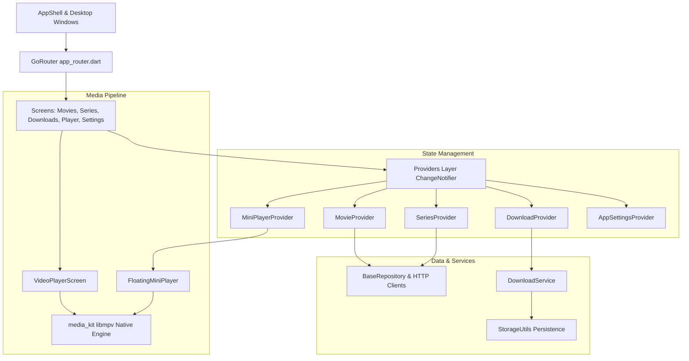

# CCloud+ System Architecture & Design

This document details the architectural layout, data pipelines, state management, and media rendering layers powering **CCloud+**.

---

## 🏗️ High-Level System Architecture

---

## 🧩 Architectural Subsystems

### 1. Presentation & Shell (`lib/src/widgets/app_shell.dart`)
- **Docked App Shell**: Persistent navigation frame featuring the Cinevex frosted sidebar (`SidebarNavigation`), top search/status bar (`AppTopBar`), and central body.
- **Floating Overlay Stack**: Houses the `FloatingMiniPlayer`, enabling seamless background playback while users browse different catalog sections.

### 2. State Management (`lib/src/providers/`)
- Powered by native Flutter `Provider` (`ChangeNotifier`).
- **`DownloadProvider`**: Manages active tasks, updates download speed calculations every second, and notifies UI listeners of progress percentage.
- **`MiniPlayerProvider`**: Coordinates seamless handoff between fullscreen playback and the corner PiP overlay without tearing down the underlying MPV player controller.
- **`MovieProvider` & `SeriesProvider`**: Handles pagination, caching, genre filtering, and the advanced multi-filter (IMDb rating, era, dubbed).

### 3. Media Playback Subsystem (`lib/src/screens/video_player_screen.dart`)
- Integrated with `media_kit` which directly communicates with the native `libmpv` shared library on Linux (`libmpv.so`), Windows (`mpv-2.dll`), and macOS (`libmpv.dylib`).
- Features hardware acceleration (VA-API / NVDEC on Linux, D3D11VA on Windows, VideoToolbox on macOS).
- Directly manipulates subtitle properties:
  - Delay adjustments via `player.platform.setSubtitleDelay(delayInSeconds)`.
  - External subtitle loading via `player.platform.setSubtitleTrack(SubtitleTrack.uri(filePath))`.

### 4. Native Chunked Downloader (`lib/src/services/download_service.dart`)
- Implements HTTP `Range: bytes=start-end` requests to allow pause, resume, and recovery from unexpected network disruptions.
- Multi-buffer streaming directly writes chunks to local storage files.
- Persists download metadata into `downloads.json` via `StorageUtils`.

### 5. Smart Error Handling & Resilience (`lib/src/core/errors/app_error_handler.dart`)
- Intercepts raw system exceptions (`HandshakeException`, `SocketException`, `TimeoutException`, HTTP 403 / 502 / 503).
- Translates technical network stack errors into user-friendly Persian diagnostic cards with suggested remedies (DNS change, retry, proxy check).
